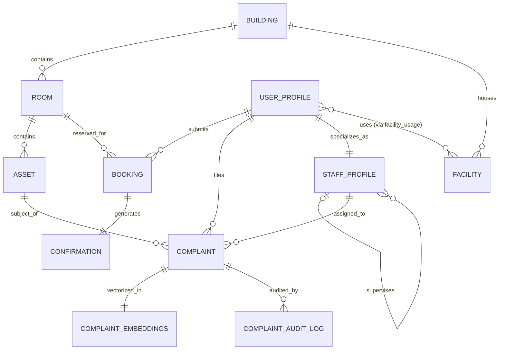

# Corrected Entity-Relationship (ER) Diagram & Model

## 1. Overview & Preservation of Chen Diagram Entities

The design strictly preserves the **nine original entities** specified in the Chen ER diagram:

1. **BUILDING**
2. **ROOM**
3. **ASSET**
4. **FACILITY**
5. **STAFF**
6. **USER**
7. **COMPLAINT**
8. **BOOKING**
9. **CONFIRMATION**

## 2. Incomplete Relationship Corrections & Normalization

1. **User Identity vs Staff Profiles**: The original model suggested separate entities for staff and user. We normalized this such that `staff_profiles` references `user_profiles` (1:1), preserving single authentication identity while allowing staff-specific attributes (`designation`, `salary`, `facility_id`).
2. **Staff Hierarchy**: Added a recursive 1:N relationship on `staff_profiles` (`supervisor_staff_id`) with a CHECK constraint enforcing `supervisor_staff_id != staff_id` (preventing self-supervision).
3. **Facility Usage**: Implemented an associative entity `facility_usage` resolving the M:N relationship between `USER` and `FACILITY`.
4. **Booking to Confirmation**: Formatted as an atomic 1:1 relationship where every successful confirmed reservation generates exactly one unique `confirmation_code`.
5. **Semantic Extensions**: Attached `complaint_embeddings` (1:1) and `complaint_audit_log` (1:N) to track vector representations and status transitions.

## 3. Mermaid ER Diagram

## 4. Cardinality Specifications

- **BUILDING (1) : ROOM (N)** — Mandatory in building, optional for new buildings.
- **ROOM (1) : ASSET (N)** — Each asset belongs to a specific room.
- **ROOM (1) : BOOKING (N)** — A room has many bookings over time; non-overlapping time ranges enforced.
- **USER (1) : BOOKING (N)** — One user can hold multiple reservations.
- **BOOKING (1) : CONFIRMATION (1)** — Exactly one confirmation record per confirmed booking.
- **ASSET (1) : COMPLAINT (N)** — An asset can accumulate multiple maintenance reports over its lifecycle.
- **USER (1) : COMPLAINT (N)** — Users raise complaints.
- **STAFF (1) : COMPLAINT (N)** — Maintenance specialists receive work assignments.
- **STAFF (1) : STAFF (N)** — Supervisor hierarchy.
